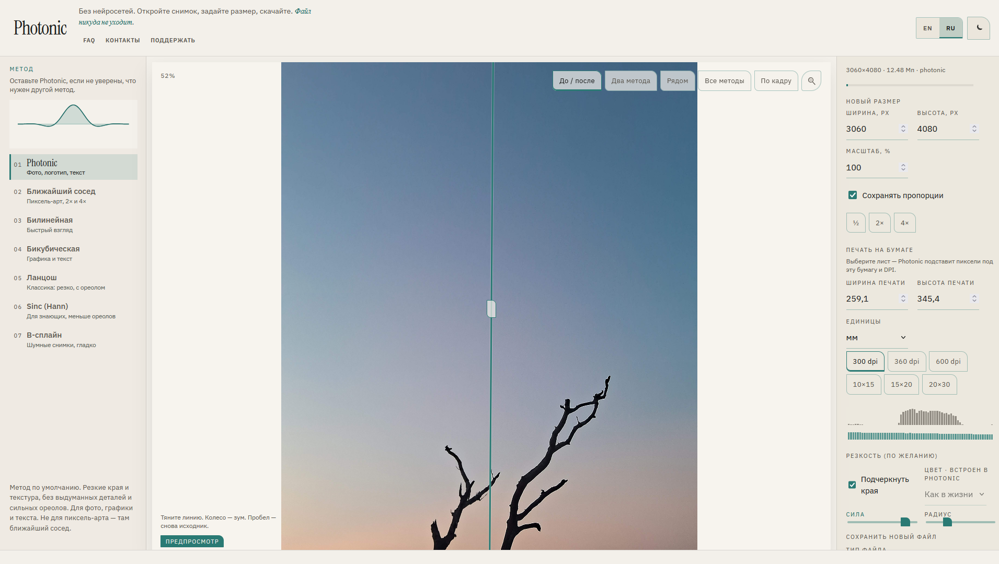
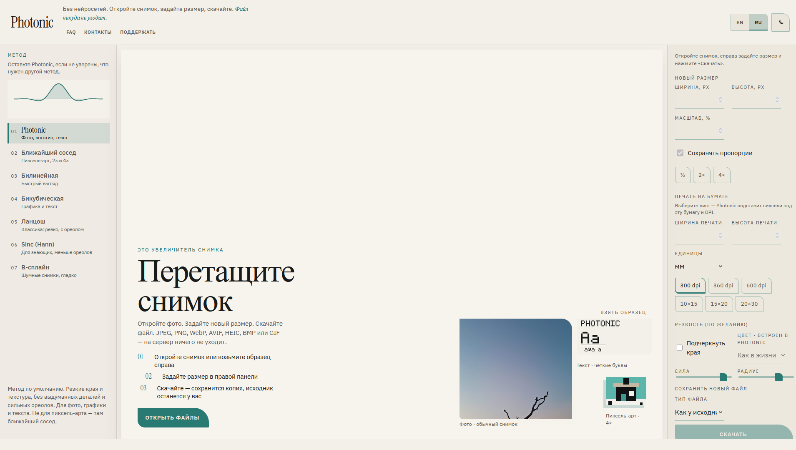
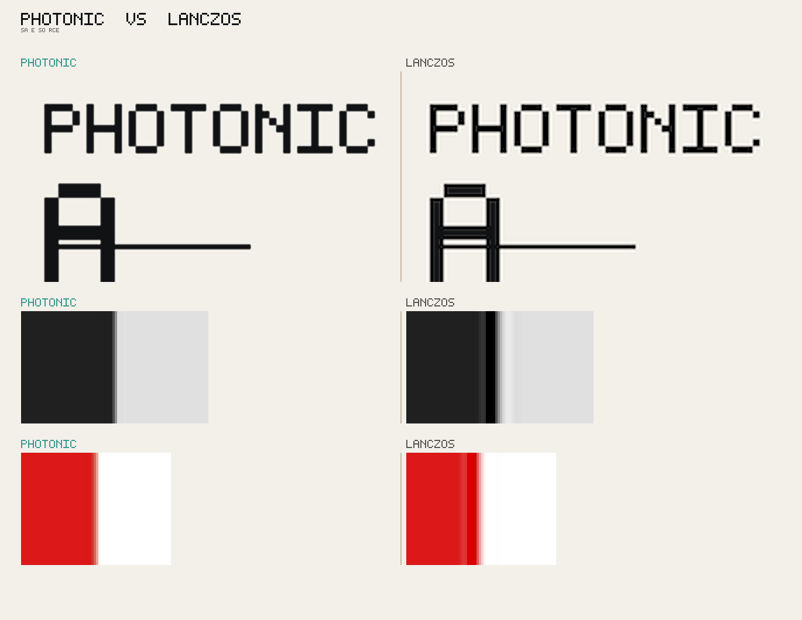
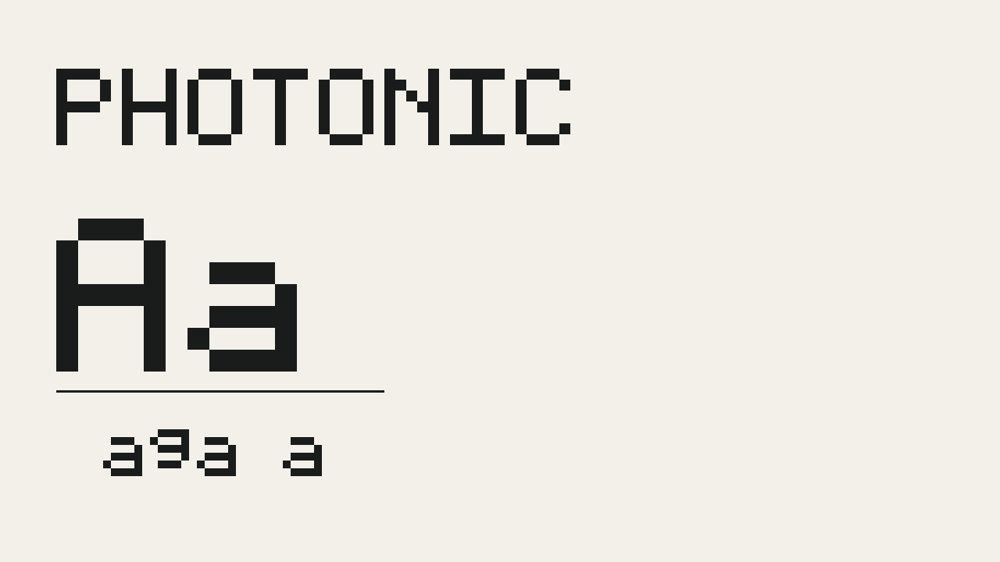
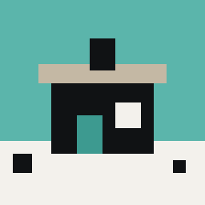
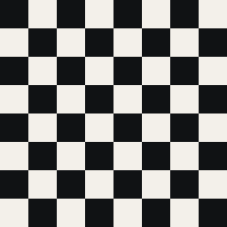

# Photonic

**Свет без нейросетей. Ядро на виду. Файл никуда не уходит.**

Photonic — увеличитель и ресемплер растра в браузере. Откройте снимок, выберите фильтр, заберите файл другого размера. Нет аккаунта, нет облака, нет «ИИ-улучшения»: только классическая интерполяция и эталонный пайплайн **Photonic**.

[Открыть Photonic](https://skaletun.github.io/Photonic/) · [GitHub](https://github.com/skaletun/Photonic)

Light without neural nets. The kernel is in view. The file stays on this device. Drop a JPEG, PNG, WebP, AVIF, HEIC, BMP or GIF, pick a kernel, export. No upload. The default **Photonic** kernel works in OKLab — sharp lightness, quieter colour, fewer halos than textbook Lanczos.



## Зачем это, а не апскейл из соцсети

Нейросеть дорисовывает то, чего не было. Photonic меняет сетку пикселей честно: вы видите форму ядра, сравниваете «до / после» или два ядра на одном кадре, удерживаете пробел (или долгий тап), чтобы снова увидеть исходник.

- Снимок не уходит с устройства. Декод, ресемплинг и экспорт идут во вкладке.
- Эталон Photonic: линейный свет, OKLab, сигмоида против ореолов, Kaiser-sinc по светлоте, Mitchell по цветности, NoHalo.
- Рядом — классика: nearest, bilinear, bicubic, Lanczos, sinc (Hann), B-spline.
- RU / EN, светлая тема по умолчанию, ставится как PWA. Офлайн кэшируется оболочка, не ваши фотографии.



## Photonic против Lanczos

Один и тот же исходник, масштаб 4×, оба прохода — настоящие ядра из репозитория, не рендер «на глаз». Слева Photonic, справа Lanczos: меньше звона на тексте и ступеньке, меньше цианового ореола на красно-белой кромке.



На столе это режим **Versus**: два полноценных ресемпла на одном сплиттере. Подписи A|B циклят ядро стороны; в рейле по-прежнему ядро экспорта.


## Образцы в приложении

Три файла лежат в [`public/samples/`](public/samples/) и открываются с пустого стола. Фото — [CC0](https://commons.wikimedia.org/wiki/File:Two_Leafless_Tree_Branches.jpg); текст и пиксель сгенерированы для звона и nearest. Подписи к кадрам README — в [`docs/readme/ATTRIBUTION.txt`](docs/readme/ATTRIBUTION.txt).

| Фото · Photonic | Текст · звон | Пиксель · 4× nearest |
| --- | --- | --- |
|  |  |  |

Клетка для nearest: [`public/assets/checker.png`](public/assets/checker.png) и профиль **4×**. Photonic на клетке чуть мягче — так задумано.



## Как пользоваться

1. Перетащите файл, вставьте его, откройте с диска (Ctrl+O) или возьмите образец. Несколько файлов — очередь справа.
2. Слева выберите ядро. **Photonic** — для фото, графики и текста. Пиксель-арт — nearest и целый 2× / 4×.
3. Справа задайте размер в пикселях, процентах, профилем ½ / 2× / 4× или листом печати (мм / дюймы, DPI 300 / 360 / 600). При «пропорциях» кадр вписывается в лист.
4. Сравните слайдером, Versus, рядом или сеткой ядер. Колесо и щипок — зум. Двойной тап — 1↔2.4, тройной тап или chip «по кадру» — сброс вида. На обзоре (больше ~8 Мп) лупа 1:1 следует за пальцем.
5. **Скачать** текущий кадр (Ctrl+S), все в ZIP или **по одному** (Safari). JPEG / PNG / WebP получают метку sRGB; EXIF копируется без GPS. Ctrl+Z / Ctrl+Y — отмена и повтор настроек.

На телефоне: превью сверху, методы чипами, **Скачать** липкой кнопкой внизу. Android Chrome после установки: «Поделиться → Photonic». iOS Safari share target не умеет — «На экран Домой» из листа «Поделиться».

Рецепт (ядро, масштаб, DPI…) копируется ссылкой без картинки.

## Горячие клавиши

- **Ctrl/Cmd+O** — открыть
- **Ctrl/Cmd+S** — экспорт
- **Ctrl/Cmd+Z** — отмена настроек
- **Ctrl/Cmd+Y** или **Shift+Z** — повтор
- **1–7** — ядра по порядку
- **+ / −** — зум
- **Пробел** — исходник, пока удерживаете

## FAQ

Полный список — в самом приложении, якорь [#faq](https://skaletun.github.io/Photonic/#faq). Коротко:

- **Это ИИ?** Нет. Именованные ядра и цветовой пайплайн, не обученная модель.
- **Куда уходит файл?** Никуда. Счёт идёт во вкладке.
- **GIF / HEIC / AVIF?** GIF — первый кадр. GIF и BMP уходят в PNG; HEIC и AVIF — в JPEG. HEIC читается нативно или через wasm, AVIF — только если браузер умеет.
- **Насколько большой экспорт?** Полное превью примерно до 8 Мп. Крупнее — обзор и лупа 1:1, полный размер считается при экспорте. Предупреждение около 80 Мп, отказ выше 120 Мп или если сторона больше 16 384 px.
- **Почему не открывается с диска?** Worker не стартует с `file://`. Нужен HTTPS или localhost.

## Контакты

Человек, не форма.

- GitHub: [skaletun](https://github.com/skaletun)
- Почта: [ettsonskal@gmail.com](mailto:ettsonskal@gmail.com)
- Telegram: [t.me/photonic_scale](https://t.me/photonic_scale)

## Поддержать проект

Без рекламы и телеметрии. Кофе или просто спасибо — чтобы увеличитель оставался на виду. Файл по-прежнему никуда не уходит.

- [Donatex](https://donatex.gg/donate/skaletun)
- [DonationAlerts](https://www.donationalerts.com/r/skaletun)
- [Т-Банк](https://www.tbank.ru/cf/4mmmJbR1Vox)

## Для тех, кто собирает из исходников

Нужен HTTP: модульный worker и service worker не живут на `file://`.

```bash
npm install
npm run dev
```

http://localhost:3000/ — локально без `basePath`. Статика:

```bash
npm test
npx tsc --noEmit
npm run build
npm start
```

`npm start` раздаёт `out/` (`next start` при `output: "export"` нет). GitHub Pages: Settings → Pages → Source: GitHub Actions. Workflow на `main` ставит `GITHUB_PAGES=true`, префикс `/<repo>/`, в `out` пишется `.nojekyll`. В git не кладите `node_modules/`, `.next/`, `out/`.

Сравнение для README и nearest-превью клетки/пикселя:

```bash
npx vite-node scripts/make-readme-images.ts
```

Браузеры: актуальные Chrome, Firefox, Safari, Edge. Шрифты в `public/fonts/` (SIL OFL), без запроса к Google Fonts.

## Лицензия

Официальным сайтом можно пользоваться бесплатно. Код, дизайн и пайплайн Photonic — все права защищены; копировать и распространять без разрешения нельзя. Шрифты остаются под SIL OFL. Это не MIT.
